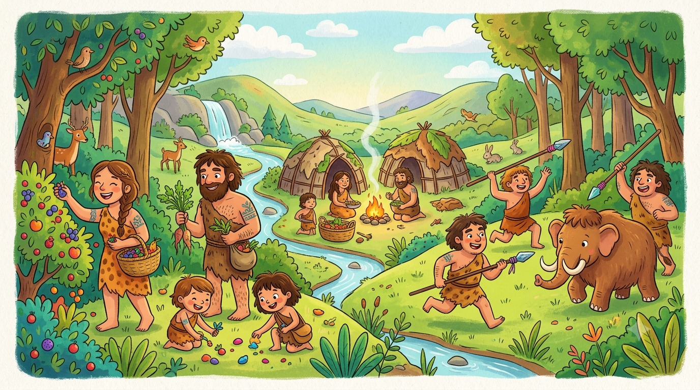
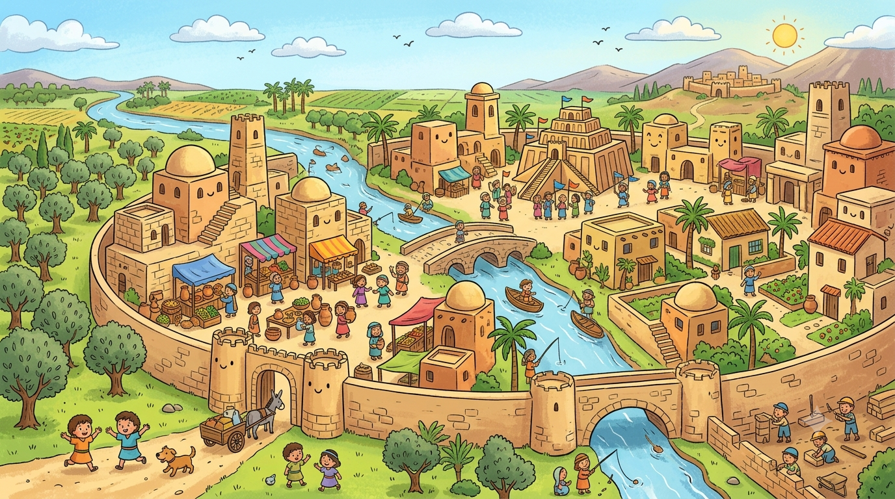
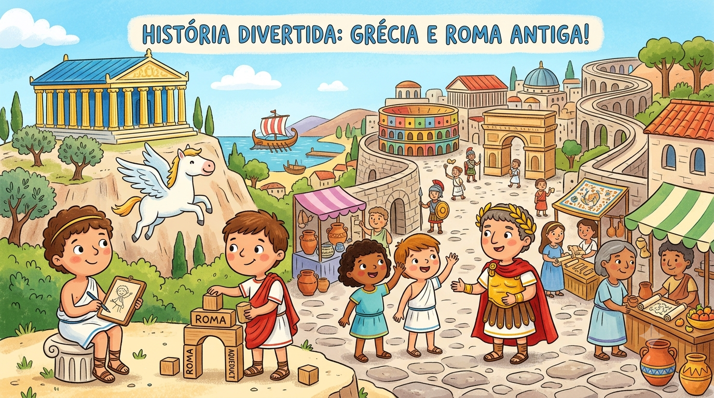
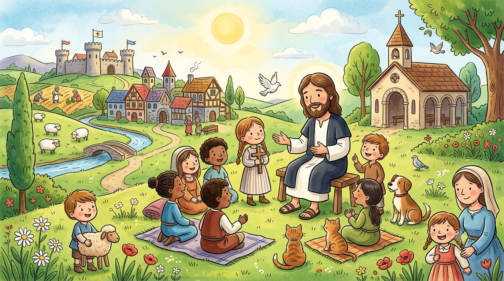
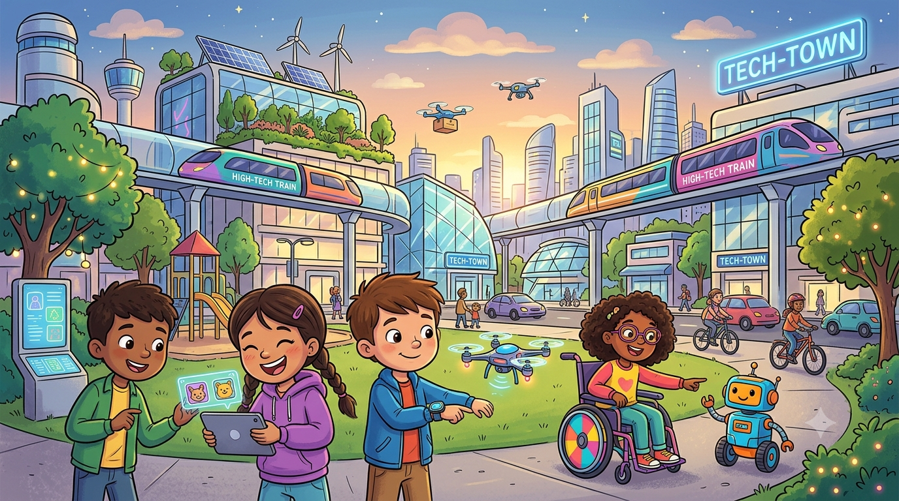

# A História das Pessoas
*Para o meu filho Miguel, que está aprendendo a ler o mundo.*

---

## Os Primeiros Humanos

Há muito tempo, não existiam cidades.

Não existiam casas.

Não existiam escolas.

As pessoas viviam na natureza.

Elas caçavam animais.

Elas procuravam frutas.

Elas bebiam água dos rios.

À noite, elas faziam fogo.

O fogo aquecia.

O fogo afastava os animais.

As pessoas dormiam juntas.

Elas se protegiam.

Elas viviam em grupos pequenos.

Esse grupo era a família delas.

---

## As Primeiras Fazendas e Cidades

Com o tempo, as pessoas aprenderam algo novo.

Elas aprenderam a plantar.

Elas colocavam sementes na terra.

A chuva molhava a terra.

O sol aquecia a terra.

As plantas cresciam.

As pessoas colhiam os frutos.

Agora elas tinham comida perto de casa.

Não precisavam mais andar tanto.

Elas ficaram em um lugar só.

Elas construíram casas simples.

Elas criaram galinhas.

Elas criaram vacas.

As aldeias foram crescendo.

Cada vez mais pessoas moravam juntas.

As aldeias viraram cidades.

As cidades tinham ruas.

As cidades tinham mercados.

As pessoas trocavam coisas entre si.

Um homem fazia potes de barro.

Outro homem plantava trigo.

Eles trocavam entre si.

Nas cidades, as pessoas aprenderam a escrever.

Elas marcavam as coisas em pedra.

Elas marcavam em barro.

Assim elas lembravam o que tinham.

Assim elas contavam histórias.

---

## Grécia e Roma

Algumas cidades ficaram muito grandes.

Algumas ficaram muito poderosas.

Na Grécia, as pessoas gostavam de pensar.

Elas faziam perguntas.

Por que o céu é azul?

O que é justo?

Como devemos viver?

Os gregos construíram templos bonitos.

Os gregos inventaram o teatro.

Os gregos criaram as olimpíadas.

Depois veio Roma.

Roma era uma cidade enorme.

Os romanos construíram estradas.

As estradas ligavam cidades distantes.

Os romanos construíram pontes.

Os romanos tinham um exército forte.

Eles conquistaram muitas terras.

Por onde passavam, eles construíam.

Muitas coisas que usamos hoje vieram dos gregos e dos romanos.

---

## Jesus e a Idade Média

Há muito tempo, nasceu um homem chamado Jesus.

Jesus vivia em uma terra chamada Israel.

Ele ensinava as pessoas.

Ele falava sobre amor.

Ele falava sobre perdão.

Ele falava sobre cuidar dos outros.

Muitas pessoas ouviram suas palavras.

Suas palavras se espalharam pelo mundo.

Depois de Jesus, vieram tempos difíceis.

As grandes cidades enfraqueceram.

As pessoas viviam em castelos.

Os castelos protegiam as pessoas.

Havia reis e rainhas.

Havia cavaleiros.

Os cavaleiros protegiam o reino.

As pessoas plantavam em volta do castelo.

A vida era simples.

A vida era dura.

Mas as pessoas continuavam aprendendo.

Elas construíam igrejas grandes e bonitas.

Elas copiavam livros à mão.

O conhecimento não se perdeu.

---

## O Mundo de Hoje

Com o tempo, tudo foi mudando.

As pessoas aprenderam a navegar.

Elas cruzaram os oceanos.

Elas descobriram novas terras.

Depois vieram as máquinas.

As máquinas faziam o trabalho mais rápido.

Depois veio a eletricidade.

As lâmpadas iluminaram as casas.

Depois vieram os carros.

Depois vieram os aviões.

Depois vieram os computadores.

Depois vieram os celulares.

Hoje as pessoas podem conversar com alguém do outro lado do mundo.

Hoje as pessoas podem aprender qualquer coisa na internet.

O mundo mudou muito.

Mas as pessoas continuam as mesmas.

Elas ainda querem comida.

Elas ainda querem família.

Elas ainda querem ser amadas.

Desde a caverna até hoje, as pessoas sempre caminharam juntas.

---

*Fim. Criado por Guilherme Ribeiro*